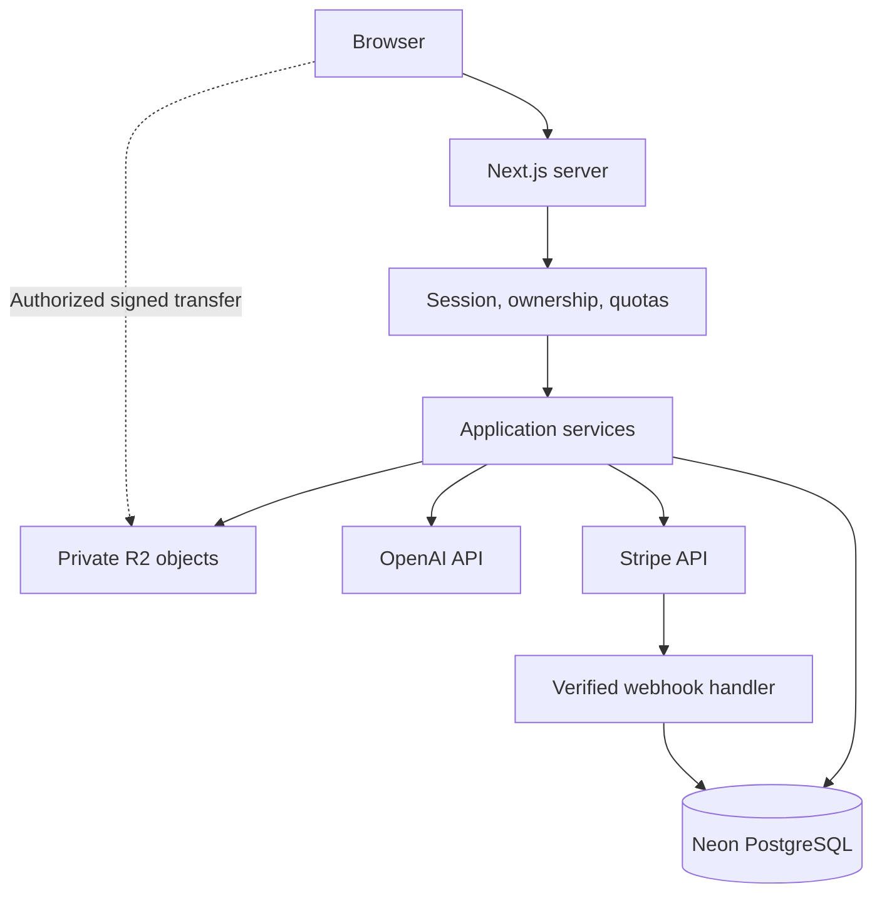
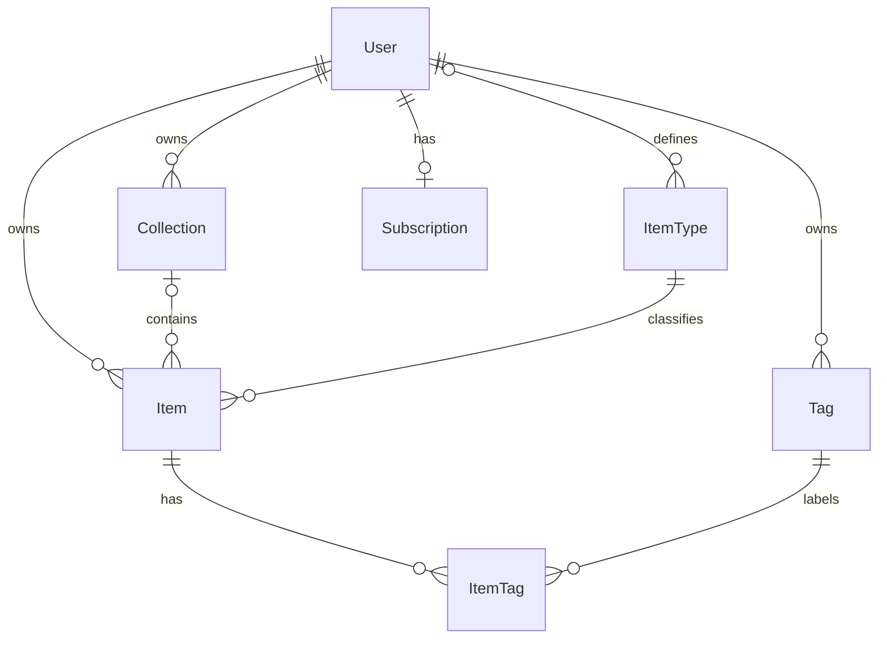
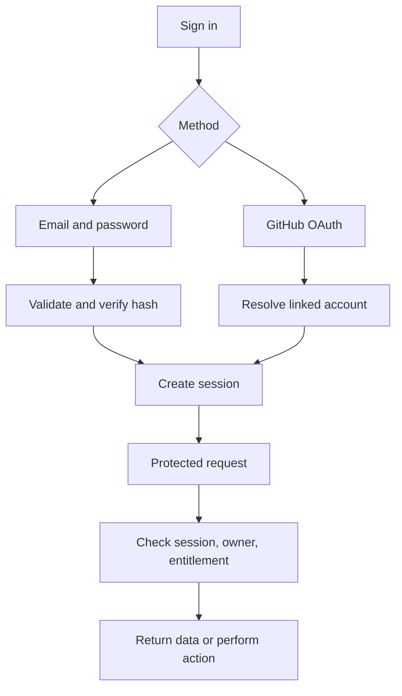
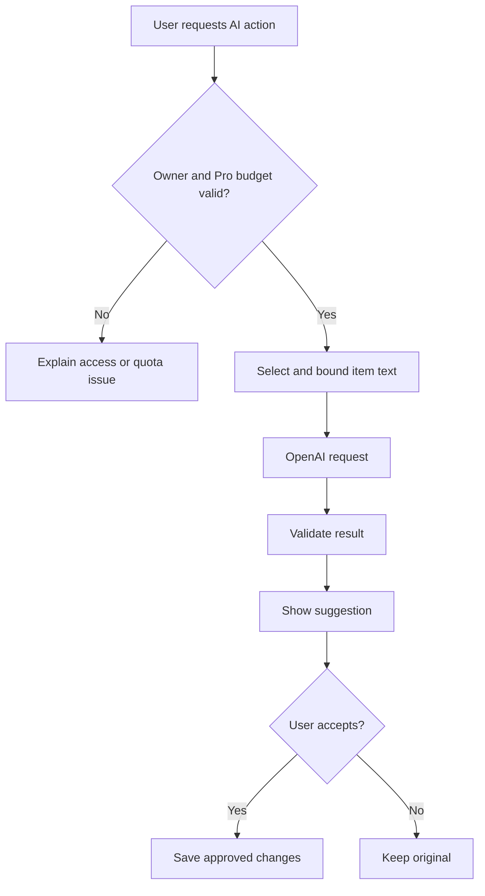

# 🚀 DevStash — Project Overview

> **Store Smarter. Build Faster.**  
> A centralized developer knowledge hub for snippets, AI prompts, notes, commands, files, images, and useful links.

**Status:** Planning · **Updated:** October 6, 2026 · **Audience:** Product, engineering, and course development

This document consolidates the original specifications into a buildable plan. Recommendations and unresolved decisions are labeled explicitly. The Prisma models are a design draft, not a deployed or migration-tested schema.

## 🧭 Contents

- [Product vision](#-product-vision)
- [Scope and item types](#-scope-and-item-types)
- [Plans and entitlements](#-plans-and-entitlements)
- [Experience](#-experience)
- [Technical architecture](#-technical-architecture)
- [Data model](#-data-model)
- [Authentication and authorization](#-authentication-and-authorization)
- [Search and files](#-search-and-files)
- [AI features](#-ai-features)
- [API surface](#-api-surface)
- [Delivery roadmap](#-delivery-roadmap)
- [Decisions before launch](#-decisions-before-launch)
- [Official references](#-official-references)

## 📌 Product vision

Developers scatter essential knowledge across editor snippets, Notion pages, AI chats, bookmarks, repository files, GitHub gists, and terminal history. Finding something again interrupts work; useful context gets lost and workflows become inconsistent.

**DevStash makes developer knowledge easy to capture, organize, find, and reuse from one private workspace.** AI enhances that workflow after the core storage and retrieval experience works reliably.

### Target users

| Persona                    | Primary need                                     | Example workflow                            |
| -------------------------- | ------------------------------------------------ | ------------------------------------------- |
| Everyday developer         | Retrieve snippets, commands, and links quickly   | Find and copy a Docker command              |
| AI-first developer         | Reuse prompts, context files, and workflows      | Adapt a saved code-review prompt            |
| Content creator / educator | Organize explanations and reusable examples      | Group course notes and sample code          |
| Full-stack builder         | Keep patterns, boilerplate, and references handy | Collect authentication implementation notes |

### Core loop

**Capture → organize → search → reuse.** Measure whether users save useful material and return to use it, rather than optimizing only for the number of stored items.

**Proposed success signals:** time to first saved item, users who save and later reuse an item, search-to-open/copy rate, weekly returning users, and Free-to-Pro conversion. Define numeric targets after an initial pilot. Avoid collecting item contents in analytics.

### Initial boundaries

The first release is a private, single-user product. Team permissions, public publishing, real-time collaboration, semantic search, code execution, and automatic crawling of saved URLs are outside the MVP.

## ✨ Scope and item types

### Built-in types

| Type    | Icon suggestion | Storage kind | Editor / behavior                                         |
| ------- | --------------- | ------------ | --------------------------------------------------------- |
| Snippet | `Code2`         | `TEXT`       | Code editor, language selector, syntax highlighting, copy |
| Prompt  | `Sparkles`      | `TEXT`       | Markdown/plain-text editor, copy                          |
| Note    | `StickyNote`    | `TEXT`       | Markdown editor and preview                               |
| Command | `Terminal`      | `TEXT`       | Plain-text command editor, copy; never execute            |
| File    | `File`          | `FILE`       | Upload metadata and authorized download                   |
| Image   | `Image`         | `FILE`       | Validated image upload and preview                        |
| URL     | `Link`          | `URL`        | HTTP(S) link with optional description                    |

Use a consistent icon set such as Lucide. Icon names are UI suggestions, not package-version guarantees.

**Custom types (Pro):** A user supplies a name, icon, color, and one existing storage kind. A custom type does not introduce executable behavior or a custom database schema. Its storage kind becomes immutable once used.

### Organization and retrieval

- **Collections:** Mixed item types, with examples such as React Patterns, Context Files, and Python Snippets.
- **Proposed MVP rule:** Each item belongs to zero or one collection. Unassigned items appear in an Inbox. This preserves the original model and keeps moving items simple.
- **Tags:** Multiple reusable tags per item, unique within a user's workspace after normalization.
- **Favorites:** A dedicated favorites view for items and collections.
- **Pins:** Items appear ahead of unpinned results; manual drag ordering is deferred.
- **Recently used:** Record deliberate opens/copies with `lastUsedAt`; do not confuse editing time with usage time.
- **Search:** Search titles, text, descriptions, tags, and type names; filter by type, collection, favorites, and tags.

### Release split

| Capability                     | MVP / Free launch                                | Pro release                                                   | Later                        |
| ------------------------------ | ------------------------------------------------ | ------------------------------------------------------------- | ---------------------------- |
| Accounts and private workspace | Email/password and GitHub                        | —                                                             | Teams                        |
| Items                          | Snippet, Prompt, Note, Command, URL, Image       | General File uploads and custom types                         | Additional integrations      |
| Organization                   | Collections, tags, favorites, pins, recent items | Higher limits                                                 | Shared collections           |
| Search                         | PostgreSQL full-text search and filters          | Same core search                                              | Semantic search if justified |
| Editing                        | Markdown, code highlighting, copy                | —                                                             | Revision history             |
| Import                         | Manual capture                                   | Basic text/Markdown/JSON import                               | External-service importers   |
| Export                         | Proposed basic JSON portability                  | ZIP with attachments                                          | Scheduled backups            |
| AI                             | None                                             | Tag suggestions, summaries, explanations, prompt optimization | Batch workflows              |
| Billing                        | Free limits enforced                             | Checkout, customer portal, webhook sync                       | Team billing                 |

**Recommendation:** Make basic JSON export available to Free users for portability; retain attachment-inclusive ZIP export as a Pro feature. This intentionally revises the original Pro-only export proposal.

## 💰 Plans and entitlements

Prices below are your proposed product pricing, not validated revenue forecasts.

| Entitlement                   | Free                            | Pro                                                        |
| ----------------------------- | ------------------------------- | ---------------------------------------------------------- |
| Price                         | $0                              | $8/month or $72/year                                       |
| Items                         | 50                              | Unlimited item count, subject to documented fair use       |
| Collections                   | 3                               | Unlimited collection count, subject to documented fair use |
| Built-in types                | All except general File uploads | All                                                        |
| Custom types                  | No                              | Yes                                                        |
| Images                        | Yes, within storage allowance   | Yes, within storage allowance                              |
| General files                 | No                              | Yes                                                        |
| Search, tags, favorites, pins | Yes                             | Yes                                                        |
| AI                            | No                              | Metered allowance; exact budget to be decided              |
| Export                        | Basic JSON recommended          | JSON and ZIP                                               |

The annual price is equivalent to $6/month when paid annually. **Unlimited items must not imply unlimited storage or unlimited AI.** Choose total storage, per-file size, import batch size, and AI budgets before accepting paid subscriptions.

### Billing rules — proposed

- Stripe is the billing source of truth; a local subscription record supports application entitlement checks.
- Derive Pro access from recognized price IDs, subscription status, and the paid access window. Avoid a separately editable `isPro` boolean.
- Grant access for `active`; support `trialing` only if trials are introduced. Define a documented grace policy for `past_due`. Other non-entitled states fall back to Free.
- Cancel-at-period-end retains Pro through the paid period. A checkout success redirect alone never grants access.
- Verify webhook signatures on the raw request body, deduplicate event IDs, and handle out-of-order events by reconciling the current subscription state. See [Stripe webhooks](https://docs.stripe.com/webhooks).
- On downgrade, preserve existing content and allow reading, copying, deleting, and basic export. Block new over-limit items/collections, new Pro-only uploads/types, and AI. Existing custom-type items remain readable and editable.
- Enforce quotas on the server. Serialize quota checks with writes—for example, lock the user's row in a transaction—so concurrent requests cannot bypass limits.

## 🎨 Experience

**Direction:** Dark mode by default; minimal, developer-friendly, keyboard-accessible. Draw inspiration from Notion's organization, Linear's clarity, and Raycast's speed without copying their branding.

| Area                | Responsibilities                                                                    |
| ------------------- | ----------------------------------------------------------------------------------- |
| Collapsible sidebar | All items, Inbox, favorites, recent items, type filters, collections, account usage |
| Workspace           | Grid/list switch, search, filters, sorting, create-item action                      |
| Full-screen editor  | Type-aware fields, tags, collection, save state, copy/download, deletion            |
| Mobile              | Drawer navigation, readable editor, accessible touch targets                        |
| Settings            | Profile, password, connected accounts, billing, usage, export, account deletion     |

**Recommended interactions:** `Cmd/Ctrl + K` focuses search; item menus remain available without keyboard shortcuts. Preserve drafts after save errors, provide visible focus indicators, label icon buttons, and keep destructive actions explicit. Sanitize rendered Markdown and avoid raw HTML by default.

**Required states:** empty workspace, no search results, loading, validation error, offline/save failure, quota reached, upload pending/failed, AI pending/failed, and expired session.

## 🧱 Technical architecture

Preserve the proposed stack, but pin compatible package versions during setup. Version names below are intended choices, not a claim that they are the latest stable releases.

| Layer                | Proposed choice                | Notes                                                 |
| -------------------- | ------------------------------ | ----------------------------------------------------- |
| Web application      | Next.js App Router + React 19  | Server rendering and interactive editors              |
| Language             | TypeScript                     | Strict mode; validate input at runtime                |
| Database             | Neon PostgreSQL                | Separate development, test, and production data       |
| ORM                  | Prisma                         | Version-pinned client, schema, and migration tooling  |
| Styling              | Tailwind CSS v4 + shadcn/ui    | Shared components and accessible interaction          |
| Authentication       | Auth.js / NextAuth v5 proposal | Verify selected release and adapter compatibility     |
| Storage              | Cloudflare R2                  | Private bucket, signed upload/download URLs           |
| AI                   | OpenAI `gpt-5-nano`            | Initial model; evaluate against real examples         |
| Billing              | Stripe                         | Checkout, customer portal, verified webhooks          |
| Hosting              | Vercel, proposed               | Check runtime and request-duration needs              |
| Monitoring           | Sentry                         | Add before public paid launch; redact content/secrets |
| Cache / coordination | Redis, optional                | Add only for measured needs; not the primary database |
| Email                | Provider to be selected        | Verification and password-reset delivery              |
| CI                   | GitHub Actions, recommended    | Lint, typecheck, tests, build, migration checks       |

### Service boundaries



Use Route Handlers and/or Server Actions as thin entry points into shared services. Every entry point performs authorization; server-rendered pages alone do not protect mutations. Keep database, R2, OpenAI, and Stripe credentials server-side. Add durable background processing when ZIP exports or imports outgrow request limits.

## 🗄️ Data model

### Design changes from the original draft

1. Rename `password` to `passwordHash`; OAuth-only users may have no password hash.
2. Replace free-form `contentType` with a storage-kind enum and a typed `ItemType` definition.
3. Store private object keys and upload state rather than permanent public file URLs.
4. Model billing state separately; derive entitlements instead of trusting `isPro`.
5. Add stable system-type keys, normalized tag/type names, explicit deletion behavior, and useful indexes.
6. Add `lastUsedAt` and a separate AI summary field so AI does not silently replace source content.

### Core relationships



System item types have no owner; custom types have exactly one owner. An item may exist without a collection.

### Prisma domain schema draft

This uses conventional Prisma model syntax, with explicit many-to-many tags. Generator, datasource, runtime adapter, and connection configuration are intentionally omitted until the Prisma major version is pinned. Auth adapter tables are described after the block; this domain draft is not a complete Auth.js adapter schema. See [Prisma relations](https://www.prisma.io/docs/orm/v7/prisma-schema/data-model/relations).

```prisma
enum ContentKind {
  TEXT
  FILE
  URL
}

enum SystemType {
  SNIPPET
  PROMPT
  NOTE
  COMMAND
  FILE
  IMAGE
  URL
}

enum UploadStatus {
  PENDING
  READY
  FAILED
}

model User {
  id               String        @id @default(cuid())
  name             String?
  email            String        @unique
  emailVerified    DateTime?
  image            String?
  passwordHash     String?
  stripeCustomerId String?       @unique
  items            Item[]
  itemTypes        ItemType[]
  collections      Collection[]
  tags             Tag[]
  subscription     Subscription?
  createdAt        DateTime      @default(now())
  updatedAt        DateTime      @updatedAt
}

model Item {
  id             String        @id @default(cuid())
  title          String
  description    String?       @db.Text
  content        String?       @db.Text
  url            String?       @db.Text
  language       String?
  aiSummary      String?       @db.Text
  isFavorite     Boolean       @default(false)
  isPinned       Boolean       @default(false)
  lastUsedAt     DateTime?

  // FILE items only; never persist an expiring signed URL.
  storageKey     String?       @unique
  fileName       String?
  mimeType       String?
  fileSizeBytes  BigInt?
  uploadStatus   UploadStatus?

  userId         String
  user           User          @relation(fields: [userId], references: [id], onDelete: Cascade)
  typeId         String
  type           ItemType      @relation(fields: [typeId], references: [id], onDelete: Restrict)
  collectionId   String?
  collection     Collection?   @relation(fields: [collectionId], references: [id], onDelete: SetNull)
  tags           ItemTag[]
  createdAt      DateTime      @default(now())
  updatedAt      DateTime      @updatedAt

  @@index([userId, updatedAt])
  @@index([userId, typeId])
  @@index([userId, collectionId])
  @@index([userId, isFavorite])
  @@index([userId, lastUsedAt])
}

model ItemType {
  id             String       @id @default(cuid())
  name           String
  normalizedName String
  systemKey      SystemType?  @unique
  contentKind    ContentKind
  icon           String?
  color          String?
  userId         String?
  user           User?        @relation(fields: [userId], references: [id], onDelete: Cascade)
  items          Item[]
  createdAt      DateTime     @default(now())
  updatedAt      DateTime     @updatedAt

  @@unique([userId, normalizedName])
}

model Collection {
  id             String   @id @default(cuid())
  name           String
  description    String?  @db.Text
  isFavorite     Boolean  @default(false)
  userId         String
  user           User     @relation(fields: [userId], references: [id], onDelete: Cascade)
  items          Item[]
  createdAt      DateTime @default(now())
  updatedAt      DateTime @updatedAt

  @@index([userId, updatedAt])
}

model Tag {
  id             String    @id @default(cuid())
  name           String
  normalizedName String
  userId         String
  user           User      @relation(fields: [userId], references: [id], onDelete: Cascade)
  items          ItemTag[]
  createdAt      DateTime  @default(now())

  @@unique([userId, normalizedName])
}

model ItemTag {
  itemId String
  tagId  String
  item   Item   @relation(fields: [itemId], references: [id], onDelete: Cascade)
  tag    Tag    @relation(fields: [tagId], references: [id], onDelete: Cascade)

  @@id([itemId, tagId])
  @@index([tagId])
}

model Subscription {
  id                   String   @id @default(cuid())
  userId               String   @unique
  user                 User     @relation(fields: [userId], references: [id], onDelete: Cascade)
  stripeSubscriptionId String   @unique
  stripePriceId        String
  // Keep provider status; map explicitly to application entitlements.
  status               String
  currentPeriodEnd     DateTime?
  cancelAtPeriodEnd    Boolean  @default(false)
  createdAt            DateTime @default(now())
  updatedAt            DateTime @updatedAt
}

model StripeWebhookEvent {
  id          String   @id // Stripe event ID for deduplication
  type        String
  processedAt DateTime @default(now())
}
```

### Invariants the model alone does not enforce

| Rule                                        | Enforcement                                                                                                            |
| ------------------------------------------- | ---------------------------------------------------------------------------------------------------------------------- |
| Every relation is within the same workspace | Services must verify collection/tag ownership and allow only system or same-user custom types before connecting IDs    |
| Global vs custom types                      | SQL CHECK: system key present + owner null, or system key null + owner present                                         |
| System types are stable                     | Idempotent seed by `systemKey`; prohibit user edits/deletes; validate the seven key-to-storage-kind mappings           |
| Text item payload                           | Require nonempty content; prohibit URL and file payload fields                                                         |
| URL item payload                            | Require validated HTTP(S) URL; prohibit text/file payload fields; use description for notes                            |
| File item payload                           | Require storage key and upload status; require verified name, MIME type, size before READY; prohibit text/URL payloads |
| Uniqueness                                  | Normalize email at account entry; normalize tag/type names consistently; preserve display spelling                     |
| Billing event processing                    | Insert event ID and apply local billing update in one transaction; rollback both on failure                            |
| Custom type deletion                        | Reassign/delete referencing items first; `Restrict` prevents accidental orphaning                                      |

**Ownership caveat:** Individual foreign keys do not prove matching owners. The draft relies on tested service checks. Consider composite foreign keys or database policies as additional protection before expanding to teams.

**Lifecycle notes:** Deleting a collection moves its items to Inbox. Deleting an item removes tag joins but requires separate R2 object cleanup. Account deletion should cancel billing, delete items before custom types, and run retryable storage cleanup. Database cascades cannot cancel Stripe subscriptions or remove R2 objects.

**Supporting models before release:** Add the official Auth.js Prisma adapter models required by the chosen session strategy (`Account` for GitHub; `Session` if using database sessions; verification models as needed), hashed single-use password-reset/email-verification tokens, and AI usage/request records for enforceable budgets. The subscription draft stores one current subscription per user; historical billing stays in Stripe unless an audit model is added. Serialize `BigInt` file sizes as strings in JSON responses.

## 🔐 Authentication and authorization

**Email/password means the Credentials provider**, not an email magic-link provider. Auth.js does not implement signup, password hashing, password resets, or abuse protection for you. Build those application flows explicitly. See [Auth.js Credentials](https://authjs.dev/getting-started/authentication/credentials).

**Proposed setup:** GitHub OAuth + Credentials, using JWT sessions after confirming the selected Auth.js version/adapter supports the combination. Persist users and linked OAuth accounts; include a stable user ID in the session. Always load current billing entitlements server-side instead of trusting a stale token claim.



- Hash passwords with a maintained password-hashing library; never log/store plaintext passwords.
- Require verified ownership before linking accounts; do not automatically merge arbitrary matching email addresses.
- Support email verification and single-use, expiring password-reset links; choose an email provider.
- Rate-limit signup, login, reset, AI, and upload endpoints. Use generic auth errors to reduce account enumeration.
- Validate sessions on every protected read/write. Take `userId` from the session, never from the client payload.
- Test cross-user IDs for item reads, edits, deletes, search, tags, collections, AI, exports, and file downloads.

## 🔎 Search and files

### Search plan

Use PostgreSQL full-text search initially. Maintain searchable item text with weighted title, description, and content; combine matches against owner-scoped tags and type names. Use PostgreSQL's `simple` text configuration as a starting proposal for code-heavy content, then evaluate realistic queries.

Add an appropriate GIN-backed search index through a SQL migration after deciding whether tags/type names are queried separately or denormalized. If denormalized, renames must refresh affected documents. The ordinary Prisma indexes above do **not** create a full-text index.

All searches begin with the authenticated owner scope, include stable pagination, and apply type/collection filters. Binary file contents, OCR, website contents, and embeddings are excluded initially; uploaded files are searchable through their title, description, filename, and tags. Test punctuation-heavy terms such as `useEffect`, `docker compose`, and `foo.bar`; add substring/trigram fallback only if observed retrieval needs it.

### Private upload lifecycle

1. Client requests an upload slot; server checks owner, type, plan, per-file limit, and remaining storage. Reserve quota against concurrent uploads.
2. Create a pending file item and a server-generated owner-scoped object key.
3. Return a short-lived signed PUT URL. Browser uploads directly to R2.
4. On completion, verify the object exists and inspect its actual size/type before marking READY; do not trust client metadata.
5. Quarantine or reject disallowed content, delete failed/orphaned uploads, and expire unused reservations.
6. Issue short-lived signed GET URLs only after checking ownership. Configure upload CORS for the application origin.

R2 supports presigned URLs for temporary access; treat those URLs as bearer capabilities and do not store or log them. See [R2 presigned URLs](https://developers.cloudflare.com/r2/api/s3/presigned-urls/).

**Proposed initial policy:** Allow a narrow set of raster image formats for Free; define a separate document/template allowlist for Pro. Disable active HTML/SVG previews and executable previews. Serve untrusted downloads as attachments. Specify scanning/quarantine requirements before enabling broad uploads.

### Import and export

- Import begins with UTF-8 text, Markdown, and a versioned DevStash JSON format; validate payload sizes and item counts before writing.
- Show a preview with conflicts/errors. Proposed default: create new items; do not silently overwrite existing data.
- JSON export includes types, collections, tags, item data, and attachment metadata—not passwords, OAuth tokens, or billing secrets.
- ZIP export includes authorized attachment bytes and a manifest. Large exports should run as durable jobs with expiring download links.

## 🧠 AI features

Keep `gpt-5-nano` as the initial proposed model. Its official model page describes support suited to tasks such as classification and summarization; validate code explanations and prompt optimization on a representative evaluation set before launch. Configure the model server-side so it can be changed deliberately. See [GPT-5 nano](https://developers.openai.com/api/docs/models/gpt-5-nano).

| Feature         | Input                                | Proposed result                                 |
| --------------- | ------------------------------------ | ----------------------------------------------- |
| Auto-tagging    | Selected item text and existing tags | Suggested tags; user accepts/rejects            |
| Summary         | Selected text                        | Preview; save to `aiSummary` on acceptance      |
| Explain code    | Snippet and language                 | Explanation with uncertainty where appropriate  |
| Optimize prompt | Original prompt and user goal        | Revised draft; user accepts or saves separately |



**Proposed safeguards:** User-triggered AI only at first; show what content will be sent. Treat stored prompts/code as untrusted input, never execute them, and give the model no infrastructure credentials or tools. Cap input/output tokens, apply per-user rate and spend limits, reserve budget before requests, and reconcile actual usage afterward. Validate structured tag output; preserve originals on errors. Define retention/logging settings and disclose third-party processing. Do not promise AI quality or unlimited usage before measuring costs.

## 🔌 API surface

Illustrative internal route design; settle naming during implementation. Keep business logic reusable across Route Handlers and Server Actions.

| Method / route                       | Purpose                       | Required checks                            |
| ------------------------------------ | ----------------------------- | ------------------------------------------ |
| `GET /api/items`                     | Search/filter/paginate        | Session, owner scope                       |
| `POST /api/items`                    | Create text/URL item          | Ownership, validation, quota, type access  |
| `GET /api/items/:id`                 | Read item                     | Ownership                                  |
| `PATCH /api/items/:id`               | Edit, favorite, pin, move     | Ownership of item and all linked records   |
| `DELETE /api/items/:id`              | Delete and schedule cleanup   | Ownership                                  |
| `POST /api/items/:id/use`            | Update recent usage           | Ownership, throttling                      |
| `GET/POST /api/collections`          | List/create collections       | Owner scope, collection quota              |
| `PATCH/DELETE /api/collections/:id`  | Edit/delete collection        | Ownership                                  |
| `GET/POST /api/tags`                 | List/create tags              | Ownership, normalized uniqueness           |
| `GET/POST /api/item-types`           | List available/create custom  | System-or-owner scope; Pro for creation    |
| `POST /api/uploads`                  | Reserve quota and sign upload | Ownership, entitlement, validation         |
| `POST /api/uploads/:itemId/complete` | Verify uploaded object        | Ownership, metadata verification           |
| `GET /api/items/:id/download`        | Sign download                 | Ownership, READY status                    |
| `POST /api/items/:id/ai`             | Generate a suggestion         | Ownership, Pro, rate/budget limits         |
| `POST /api/imports`                  | Import validated records      | Ownership, entitlement, quotas             |
| `POST /api/exports`                  | Create JSON/ZIP export        | Owner scope, format entitlement            |
| `POST /api/billing/checkout`         | Start checkout                | Session, allowlisted price                 |
| `POST /api/billing/portal`           | Manage subscription           | Session, own Stripe customer               |
| `POST /api/webhooks/stripe`          | Sync billing state            | Signature, idempotency; no browser session |

Use consistent JSON errors with a machine-readable code and safe message. Suggested statuses: `401` missing/invalid session, `404` unavailable or foreign resource, `403` missing entitlement, `409` conflict/quota reached, `422` invalid input, and `429` rate limit. Use parameterized SQL for search; never concatenate query text.

## 🗂️ Delivery roadmap

### Phase 0 — Foundation

- [ ] Pin compatible framework, React, Prisma, and Auth.js versions.
- [ ] Create app, development database, migrations, and system-type seed.
- [ ] Build responsive shell, shared UI, validation conventions, and environment documentation.
- [ ] Configure linting, typechecks, CI, and isolated test database.

**Exit:** Reproducible setup, fresh database migration succeeds, shell usable on mobile/desktop.

### Phase 1 — Private MVP

- [ ] Signup/sign-in, GitHub OAuth, verification/reset flows, protected workspace.
- [ ] Text/URL CRUD, collections, tags, favorites, pins, recent usage.
- [ ] Full-text search and filters; Free quotas enforced under concurrency.
- [ ] Private image uploads with verified completion and cleanup.
- [ ] Basic JSON export, recommended.

**Exit:** A user can save, find, reuse, and remove material; cross-user access tests pass; failures preserve drafts and originals.

### Phase 2 — Paid product

- [ ] Stripe checkout, customer portal, verified replay-safe webhooks, downgrade behavior.
- [ ] Custom types, general file uploads, import, attachment-inclusive ZIP export.
- [ ] AI suggestions and usage metering.
- [ ] Privacy controls, account deletion, monitoring, backup/restore procedure.

**Exit:** Billing retries and event ordering tested; paid access is server-enforced; AI/storage budgets measured; no silent data loss after downgrade.

### Phase 3 — Expansion

Shared collections, teams/organizations, VS Code extension, browser extension, and public API/CLI. Introduce an explicit workspace/membership authorization model before building collaboration.

### Testing priorities

| Area          | Meaningful acceptance check                                                                |
| ------------- | ------------------------------------------------------------------------------------------ |
| Isolation     | User A cannot access or link User B's resources through any endpoint                       |
| Quotas        | Two simultaneous creates at 49/50 cannot both succeed                                      |
| Billing       | Duplicate and out-of-order events cannot incorrectly grant/revoke access                   |
| Uploads       | Oversized, wrong-type, failed, or incomplete uploads never become usable                   |
| Search        | Results exclude other users and include expected tag/type matches                          |
| AI            | Invalid output or provider failure preserves original content and correct usage accounting |
| Deletion      | Collection deletion preserves items; file/account cleanup retries safely                   |
| Accessibility | Core capture/search/edit workflow works by keyboard and on mobile                          |

### Screenshots

Refer to the screenshots below as a base for the dashboard UI. It does not have to be exact. Use it as a reference:

@context/screenshots/devstash_dashboard_ui_main.png
@context/screenshots/devstash_ui_drawer.png

### Course workflow

Use one branch per lesson, as planned, and keep `main` as the reviewed integration branch. Add immutable checkpoint tags for reproducible student starting points. Include each lesson's objective, prerequisites, migration steps, and acceptance criteria.

```bash
git switch main
git pull --ff-only
git switch -c lesson-01-setup
```

Cursor, Claude Code, and ChatGPT can support implementation and explanations; review generated code and verify behavior with tests. Never paste production secrets or private user content into course examples.

## ✅ Decisions before launch

| Decision              | Proposed default / unresolved point                                              |
| --------------------- | -------------------------------------------------------------------------------- |
| Collection membership | One optional collection per item; expand only if demand supports it              |
| Free export           | Basic JSON recommended; confirm change from original pricing scope               |
| Quotas                | Choose storage, file size, import batch, and AI usage budgets                    |
| Billing               | Confirm grace period, trials, supported currency/tax handling, and refund policy |
| Authentication        | Verify package compatibility, choose email delivery, define safe linking         |
| Files                 | Confirm allowed types, quarantine/scanning, and retention/cleanup policy         |
| Search                | Measure code-token retrieval and choose fallback behavior                        |
| AI                    | Evaluate model quality/cost; define disclosure and data handling                 |
| Hosting               | Confirm execution limits and background job solution                             |
| Operations            | Define backups, restore testing, retention, and account deletion behavior        |

**Next milestone:** Complete Phase 0, then implement one end-to-end vertical slice: sign in → create a snippet → find it → copy it → verify another user cannot access it.

## 📚 Official references

Core Prisma relations, Auth.js Credentials, R2 presigned URLs, Stripe webhooks, and GPT-5 nano references checked October 6, 2026; additional links are provided for setup. Package APIs and availability can change; use documentation matching pinned versions. Product scope, quotas, architecture choices, and rollout order above are DevStash proposals.

- [Next.js documentation](https://nextjs.org/docs)
- [Prisma relation modeling, version 7 reference](https://www.prisma.io/docs/orm/v7/prisma-schema/data-model/relations)
- [Neon documentation](https://neon.com/docs)
- [PostgreSQL full-text search](https://www.postgresql.org/docs/current/textsearch.html)
- [Auth.js Credentials](https://authjs.dev/getting-started/authentication/credentials)
- [Auth.js Prisma adapter](https://authjs.dev/getting-started/adapters/prisma)
- [Cloudflare R2 presigned URLs](https://developers.cloudflare.com/r2/api/s3/presigned-urls/)
- [Stripe webhooks](https://docs.stripe.com/webhooks)
- [OpenAI GPT-5 nano](https://developers.openai.com/api/docs/models/gpt-5-nano)
- [Tailwind CSS](https://tailwindcss.com/docs) · [shadcn/ui](https://ui.shadcn.com/docs) · [Lucide](https://lucide.dev/icons/)
- [Vercel documentation](https://vercel.com/docs) · [Sentry for Next.js](https://docs.sentry.io/platforms/javascript/guides/nextjs/)

---

**DevStash — Store Smarter. Build Faster.**
